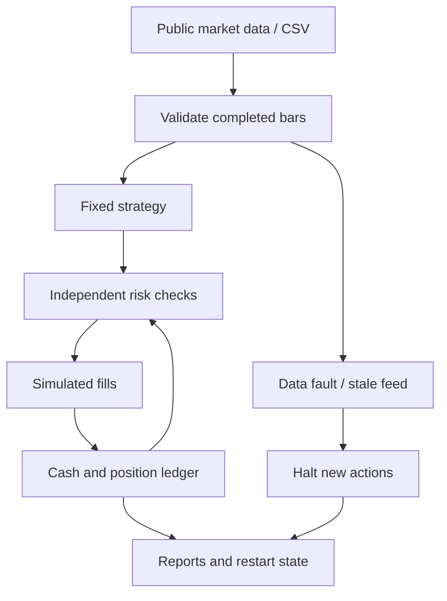

# Experimental architecture and design

Date: 2026-10-13. Scope: deterministic research and paper simulation only. Basis: requirements.md and primary-source engine research; original MIT-licensed code with no upstream runtime dependency.

## Alternatives and choice

1. A small Python standard-library harness is selected for the first experiment. It offers explicit timing/accounting/risk behavior, zero package dependency at runtime, deterministic tests and no signing capability. Its cost is a less detailed execution model than a mature exchange simulator; results cannot establish live DEX performance.
2. Hummingbot plus Gateway is a possible future execution stack. Official documentation confirms Solana/EVM DEX routing and AMM/CLMM support; wallet functions and reported attack surfaces require separate isolation and audit. It is not activated or forked now.
3. Freqtrade, LEAN and Nautilus can provide external benchmark engines. Freqtrade's documented Hyperliquid support must be distinguished from generic onchain AMMs. Adopting a full engine before credible economics and eligible access adds operational surface without demonstrated value.

## Modules

`src/arz/data.py` validates OHLCV identity, finite positive prices, OHLC consistency, nonnegative volume, chronological order, interval alignment, missing bars and completion. `strategies.py` contains three fixed long-only strategies. `risk.py` independently enforces simulation bounds. `accounting.py` accounts for cash, units, realized/unrealized P&L and every fill cost. `engine.py` supplies the same closed-bar state machine to historical and paper commands. `connectors.py` contains a fixed-host HTTPS GET analytics connector only. `paper.py` journals state with file locking and atomic replace; no automatic historical catch-up fills after outages. `economics.py` produces hypothetical growth/cost/loss tables. `metrics.py` and reporting scripts export auditable CSV/JSON and figures.

## Time and accounting contract

For historical runs, a candle timestamp is its interval start. A decision at candle t close may fill only at candle t+1 open. Prospective paper fills instead use a genuinely newly observed completed close with adverse modeled slippage and the actual observation clock; they never claim an old opening price. Current high, low, close and volume cannot improve the fill or alter the prior signal. The liquidity cap uses previous completed volume, never the execution bar's future volume. Price gaps count in marked equity. Slippage is always adverse. Fees are charged per side; network cost is charged on attempted simulated transactions, including injected failures. No same-bar stop fill is assumed. A kill event stops entries; reduction is attempted only with valid data and executable cost constraints. Open exposure remains risky during faults.

A single position buys up to a fixed $20 notional, capped by order/position/cash/reserve/previous-volume rules. No incremental averaging down or compounding order size. An exit can be split across bars if the notional exceeds the per-order cap; dust and expensive exits remain open and are reported. Capital cap applies to initial external funds, not a ban on earned gains. Matched-capital buy-and-hold is a comparison, with full-capital buy-and-hold separately labelled unbounded by the strategy's exposure rules.

## Preliminary cost model

For the selected Base Uniswap v3 WETH/USDC research pool, use the displayed 0.05% fee tier as a provisional input (5 bps), 10 bps adverse slippage, and $0.01 per attempted fill network cost. Only the pool fee tier is observed in metadata; slippage/gas are assumptions awaiting per-route calibration. Sensitivities double costs and include high gas/slippage that risk may reject. USD is the reporting numeraire; assuming stablecoin parity is a disclosed limitation, with depeg/total-loss scenarios in economic stress analysis. OHLCV backtests cannot model current tick liquidity, MEV, reorderings, reorgs or fills reliably.

## Paper operations

A bounded CLI fetches completed public analytics bars, warms indicators without retroactive trades and processes genuinely subsequent bars. It records observed time, source interval, state version and hashes. Repeated bars are idempotent; conflicting bars or restart configuration mismatch fail closed. A stale or broken feed never produces new orders. Restart after missed bars halts rather than inventing trades while offline. The shared engine is paper simulation, not a mainnet transaction adapter. No continuous service is installed in this session, and a short collection is not multiweek performance evidence.

## Verification focus

Independent literal accounting examples; future-bar perturbation; stale/future/NaN/missing/duplicate data; invalid/oversized settings and mode changes; loss and fee caps; failed transaction gas; repeated/restarted journals; injected network failures; deterministic historical reruns; untouched OOS/forward folds; reduced exposure comparison; cost stress and gap loss. Every claim identifies executed versus unavailable checks.
