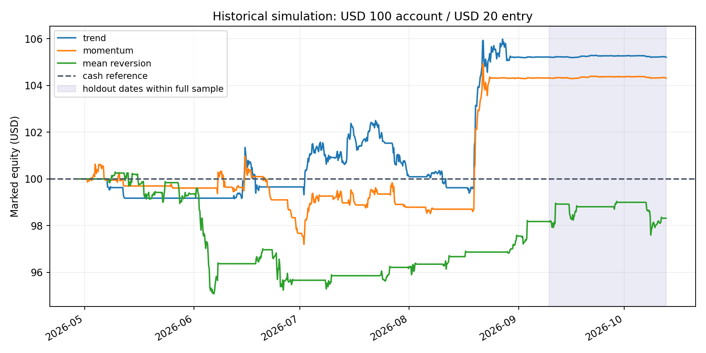
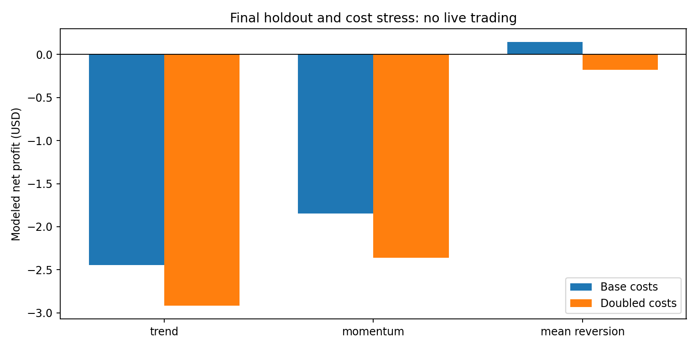

# Strategy evaluation: three fixed hypotheses

**Saved run: 2026-10-13 01:31:31 UTC. Decision: NO-GO for real funds; performance qualification PENDING.** These are historical price simulations, not DEX fills, prospective paper results or confirmed profits. Exactly three original strategies were tested; AI is off. [Run manifest](../../reports/backtests/manifest.json)

## 1. Rules fixed before performance testing

[Preregistration](../../configs/preregistered_strategies.json) records **2026-10-13 01:02:42.106870 UTC**, before the first performance run. The recorded remote pre-test checkpoint is [eb837d09eaef38dc9cd38a13efcf86d00235e35d](https://github.com/DashSaman/Arz/commit/eb837d09eaef38dc9cd38a13efcf86d00235e35d). Connectivity probes preceded registration. Parameters were not optimized; prior asset/pool selection remains a source of bias.

| Hypothesis | Exact implemented long/flat rule |
|---|---|
| Trend | After 48 closes, long when the 12-close arithmetic mean exceeds the 48-close mean; otherwise flat. |
| Momentum | Compare the latest close with the close 12 bars earlier. Enter above +2%; remain long while the return is strictly above zero. |
| Mean reversion | Use the latest 24 closes, including the current close, and population standard deviation. Enter at z ≤ −1.5; remain long while z < 0. Zero variance gives flat. |

Source: [implemented strategies](../../src/arz/strategies.py). The hypotheses respectively ask whether trend persistence, recent positive momentum or recovery from a negative deviation survives costs. These are questions, not established mechanisms of profit.

The [configuration](../../configs/research.json) starts with **$100**, targets one fixed **$20 entry**, caps a single order at **$25**, and reserves **$10**. There is no incremental averaging, leverage, borrowing, martingale or replenishment. The $5 minimum is a model rule, not a verified venue minimum. Exits may split under the order cap; uneconomic dust can remain open. The initial-capital ceiling does not prohibit simulated equity exceeding $100 through gains.

Configured guards include 3% daily loss, 10% drawdown, four counted transactions and $2 fees per day, plus a 0.1% previous-volume participation cap. Slippage and network-cost ceilings are 50 bps and $0.10. These are simulation rules, not guaranteed live loss limits.

## 2. Data, timing and chronological segments

The dataset contains **999 completed four-hour bars** from Base WETH/USDC pool `0xd0b53d9277642d899df5c87a3966a349a798f224`. All times below are UTC; ends are exclusive and include the last candle's four-hour duration.

| Segment | Index range | Start, 2026 | End, 2026 | Duration |
|---|---|---|---|---:|
| Full exploratory | [0,999) | 04-29 12:00 | 10-13 00:00 | 166.5 days |
| Development | [0,399) | 04-29 12:00 | 07-05 00:00 | 66.5 days |
| Forward 1 | [399,599) | 07-05 00:00 | 08-07 08:00 | 33⅓ days |
| Forward 2 | [599,799) | 08-07 08:00 | 09-09 16:00 | 33⅓ days |
| Final holdout / forward 3 | [799,999) | 09-09 16:00 | 10-13 00:00 | 33⅓ days |

Each forward run restarts at $100 with no position; preceding bars warm indicators without trades. Historical context expands, but no learned model is fitted. These are not a continuously compounded walk-forward portfolio. The holdout is the final forward fold, not extra independent evidence. [Runner](../../scripts/run_research.py), [fold implementation](../../src/arz/validation.py)

Signals use completed bars and historical fills use the subsequent bar's open with adverse slippage. The volume cap uses previous completed volume. Current-bar highs/lows cannot supply favorable retrospective fills. Candle prices still lack executable tick depth, queue position, MEV, reordering, actual gas, depeg and transaction-failure history. [Execution model](../../src/arz/engine.py)

## 3. All chronological outcomes

Returns below are net modeled changes in the entire $100 account. Each strategy cell links to its granular run record.

| Segment | Trend | Momentum | Mean reversion | $20 buy-and-hold | Full-capital buy-and-hold |
|---|---:|---:|---:|---:|---:|
| Full exploratory | [+5.2023%](../../reports/backtests/full_exploratory_trend.json) | [+4.3072%](../../reports/backtests/full_exploratory_momentum.json) | [−1.6815%](../../reports/backtests/full_exploratory_mean_reversion.json) | +0.9363% | +4.7187% |
| Development | [+1.3428%](../../reports/backtests/development_trend.json) | [−0.7782%](../../reports/backtests/development_momentum.json) | [−4.3369%](../../reports/backtests/development_mean_reversion.json) | −4.7743% | −23.8173% |
| Forward 1 | [−1.2482%](../../reports/backtests/walk_forward_1_trend.json) | [−0.6844%](../../reports/backtests/walk_forward_1_momentum.json) | [+0.6877%](../../reports/backtests/walk_forward_1_mean_reversion.json) | +1.3347% | +6.7095% |
| Forward 2 | [+5.0737%](../../reports/backtests/walk_forward_2_trend.json) | [+5.5631%](../../reports/backtests/walk_forward_2_momentum.json) | [+1.8249%](../../reports/backtests/walk_forward_2_mean_reversion.json) | +6.1539% | +30.7911% |
| Final holdout | [−2.4443%](../../reports/backtests/final_holdout_trend.json) | [−1.8463%](../../reports/backtests/final_holdout_momentum.json) | [+0.1427%](../../reports/backtests/final_holdout_mean_reversion.json) | −0.4048% | −1.9828% |

Source: [summary](../../reports/backtests/summary.csv), [benchmarks](../../reports/backtests/benchmarks.csv). Positive full-history trend/momentum results do not survive the final window. All three gain in forward 2, but the $20 buy-and-hold comparator gains more. Selection of only the favorable period would conceal this variability.

Buy-and-hold matches the initial $20 target, not the strategy's changing exposure or timing. It pays entry costs and remains marked open, with no invented terminal sale. The full-capital comparator bypasses strategy exposure/reserve constraints; its full-period drawdown is approximately **35.99%**, versus **7.386%** for the $20 comparator. Cash stays at $100 with zero accounting return and drawdown, without modeling issuer, depeg or opportunity cost.

The chart follows uninterrupted exploratory runs. Its shaded final interval is not the independently reset holdout portfolio.

## 4. Every metric needs its correct denominator

The final holdout has **34 sampled daily returns** over 33⅓ days, including partial boundary days. USD figures below are rounded; raw values remain in the linked run JSON and comparison CSV.

| Metric | Trend | Momentum | Mean reversion |
|---|---:|---:|---:|
| Ending equity / net profit, USD | 97.5557 / −2.4443 | 98.1537 / −1.8463 | 100.1427 / +0.1427 |
| Maximum drawdown | 2.4443% | 2.6857% | 1.4295% |
| Closed cycles / open positions / fills | 6 / 0 / 12 | 6 / 1 / 13 | 4 / 0 / 8 |
| Profit factor / win rate | 0.0883 / 16.67% | 0.5150 / 16.67% | 1.1802 / 50% |
| Average win / average loss, USD | 0.2367 / −0.5362 | 1.1724 / −0.4553 | 0.4674 / −0.3960 |
| Average win/loss magnitude ratio | 0.4415 | 2.5748 | 1.1802 |
| Sharpe / Sortino | −4.5882 / −5.7315 | −3.4714 / −4.5412 | 0.3202 / 0.4736 |
| Average capital exposure / time in market | 11.6113% / 57% | 6.6609% / 33% | 5.5640% / 28.5% |
| Turnover, times initial capital | 2.3779 | 2.5914 | 1.6030 |
| Commission / network / total fees, USD | 0.1189 / 0.1200 / 0.2389 | 0.1296 / 0.1300 / 0.2596 | 0.0802 / 0.0800 / 0.1602 |
| Slippage cost, USD | 0.2378 | 0.2591 | 0.1603 |
| Realized / unrealized P&L, USD | −2.4443 / 0 | −1.1043 / −0.7420 | +0.1427 / 0 |
| Conditional mean-daily-return interval | [−0.13984%, +0.01159%] | [−0.13973%, +0.05493%] | [−0.06974%, +0.07798%] |

`net_profit` is ending minus initial equity; `net_return` divides by initial capital. Drawdown measures peak-to-trough marked equity. Realized P&L includes partial sales; unrealized P&L marks remaining inventory without assuming liquidation. Profit factor, wins and average wins/losses use **fully closed cycles only**. Thus partial realized gains in an open cycle can coexist with a closed-cycle profit factor below one. Missing denominators produce null, not infinite profitability. [Accounting](../../src/arz/accounting.py), [metric definitions](../../src/arz/metrics.py)

Exposure averages position value/equity; time in market counts bars with inventory; turnover sums both-side notional/initial capital. Commission and network charges sum to `total_fees`. Slippage is already reflected in fill prices and must not be subtracted again. Sharpe uses annualized daily mean/standard deviation with zero reference return; Sortino uses downside deviation. Their minimum 30-observation rule is a computation condition, not adequate statistical evidence.

`excess_vs_20usd_buy_hold` subtracts the comparator's net return: holdout differences are −2.0395, −1.4415 and +0.5475 percentage points. Exposure is not matched through time, so these differences are not risk-adjusted alpha.

Baseline holdouts have zero `failed_attempts`, zero `rejected_orders` and no `halt_reason`. That does not estimate a real failure rate. Full trend/momentum runs record **120/142 dust/minimum-order rejections**; forward 2 records **34/41**. Residual inventory can remain exposed. [Trend event ledger](../../reports/backtests/full_exploratory_trend_events.csv)

`case`, `strategy`, start/end indexes, first/last candle timestamps and `sample_days` identify the evaluation slice. Input, configuration, code and strategy hashes identify provenance. Per-run `daily_returns`, portfolio cash/units/cost basis, execution class and warnings allow reconciliation; the summary is not a complete fill ledger.

## 5. Costs and conditional uncertainty

Baseline assumptions are **5 bps commission per side, 10 bps adverse slippage per side and $0.01 network cost per attempted transaction**. Only the pool fee tier was observed in metadata; execution costs need calibration.

| Holdout scenario | Trend net return | Momentum net return | Mean-reversion net return |
|---|---:|---:|---:|
| Double all three costs: 10/20 bps, $0.02 | −2.9183% | −2.3629% | −0.1777% |
| Network $0.10; other inputs unchanged | −3.5243% | −3.0163% | −0.5773% |
| Network $1; cap remains $0.10 | 0%, no fills | 0%, no fills | 0%, no fills |

The final scenario rejects **114/43/28** attempted entries before execution. Zero return is a risk rejection outcome, not trading success. These sensitivities reuse the holdout; 24 recorded runs are not 24 independent tests. [Stress records](../../reports/backtests/holdout_double_cost_mean_reversion.json), [gas rejection ledger](../../reports/backtests/holdout_gas_100_rejected_trend_events.csv)

The bootstrap uses 2,000 circular seven-day block resamples, seed 20261013, with 2.5th/97.5th percentile bounds. **All three baseline holdout intervals include zero.** Forward-2 mean reversion has a positive lower bound, while trend at $0.10 gas has a negative upper bound; neither exception establishes durable alpha. Selection, multiple comparisons, model errors and regime changes are uncorrected.

`net_positive` is merely a sign test. `at_least_100_closed_trades` is false everywhere and is only an internal screen. `conditional_mean_lower_positive` records one conditional interval, not a profitability probability. Four to six holdout cycles are insufficient for qualification.

## 6. Deferred hypotheses and reproducibility

| Approach | Status and reason |
|---|---|
| Grid | **UNTESTED**; requires inventory, many-order and transaction-cost modeling. |
| DCA | **UNTESTED**; needs separate contribution/inventory rules; current engine does not average down. |
| Statistical arbitrage | **UNTESTED**; needs synchronized multi-asset data, hedge design and selection controls. |
| Market making | **UNTESTED**; queue position, nonfills and adverse selection are absent. |
| LP | **UNTESTED**; ranges/bins, fee shares, inventory and depeg require another simulator. |
| AI/ML | **UNTESTED**; disabled until feature timing and incremental independent benefit are established. |

Only the three tested hypotheses are active. No performance labels are assigned to deferred approaches.

Exact input SHA-256:

`283346087387fac0d312971e8c408c16d184212efe1458e06b692d0daf351e30`

Reproduction requires authorized input matching that checksum, recorded configuration and code/strategy hashes, and the fixed runner. Raw/normalized provider data are not shared while rights and retention remain unresolved; **full independent reproducibility is therefore PENDING**. The [three-row comparison](../../research/strategy_comparison.csv) preserves every holdout summary field and cross-case references. See [access](dex_access.md) and [research synthesis](research_report.md) for independent execution barriers. No live or Level-4 prospective-paper qualification follows from these files.
